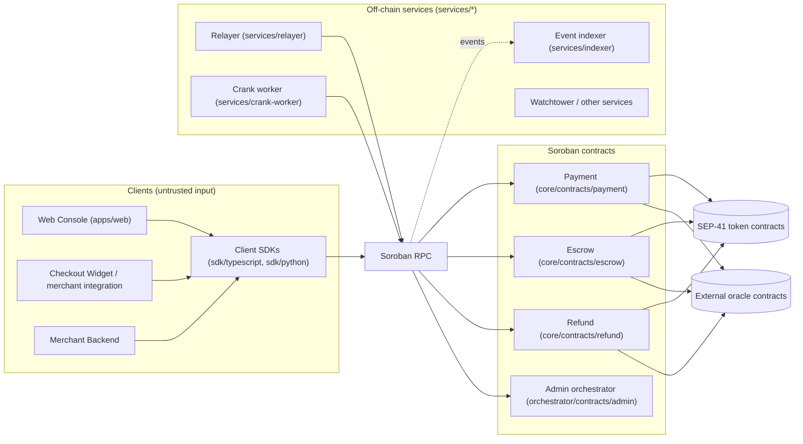
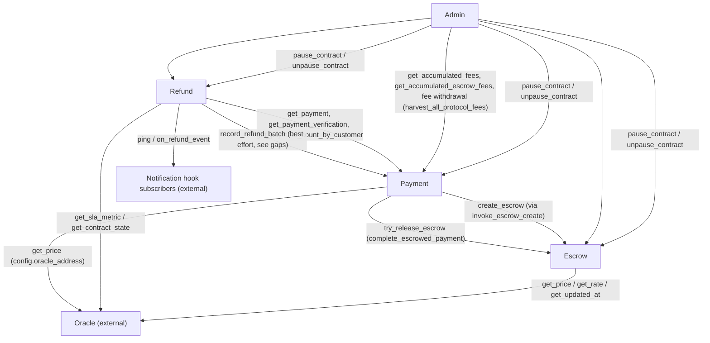
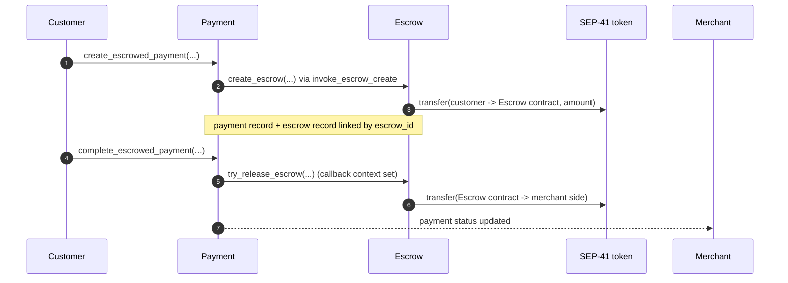
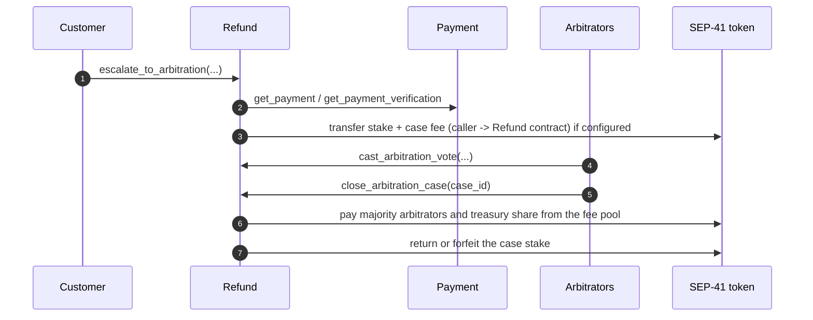
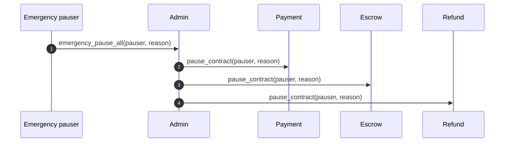
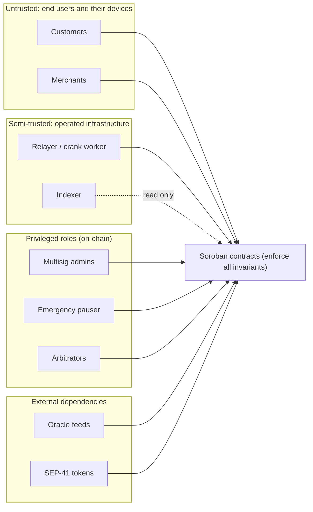

# System Architecture Overview

This document is a code-derived architecture specification for Cypher GridPay: the components, the trust boundaries between them, the cross-contract call graph, and where tokens are held at each lifecycle stage. It complements the shorter [ARCHITECTURE.md](./ARCHITECTURE.md), which covers storage tiers, schema versioning and archival.

> **Scope and accuracy.** Every contract method named below was checked against `core/contracts/{payment,escrow,refund}/src/lib.rs` or `orchestrator/contracts/admin/src/lib.rs` at the time of writing. Where the code is unclear, incomplete or appears to be a placeholder, this document says so under [Known gaps](#known-gaps-observed-in-the-code) instead of guessing. Off-chain components (web console, checkout widget, merchant backend) are described only at the level documented elsewhere in `docs/`; this file does not specify their internals.

## 1. Component map

Off-chain services only reach the contracts through Soroban RPC and the contracts' public methods; they hold no special on-chain privilege unless their account is added to an admin or pauser role. See [EVENT_INDEXER_ARCHITECTURE.md](./EVENT_INDEXER_ARCHITECTURE.md), [BACKEND_SERVICES_ARCHITECTURE.md](./BACKEND_SERVICES_ARCHITECTURE.md) and the per-service READMEs for the off-chain side.

## 2. Contract responsibilities

| Contract | Source | Primary responsibility | Representative methods |
| --- | --- | --- | --- |
| Payment | `core/contracts/payment/src/lib.rs` | Payment lifecycle, platform fee (`FeeConfig`), fee tiers, merchant fee rebates, split payments, fee sweeps | `create_payment`, `complete_payment`, `refund_payment`, `create_escrowed_payment`, `complete_escrowed_payment`, `create_split_payment`, `execute_split_settlement`, `set_fee_config`, `claim_fee_rebate`, `sweep_fees` |
| Escrow | `core/contracts/escrow/src/lib.rs` | Locked funds, disputes, vesting schedules, collateral, oracle-conditioned release | `create_escrow`, `release_escrow`, `create_vesting_escrow`, `release_vested_amount`, `claim_vested_escrow_tokens`, `revoke_unvested_escrow`, `liquidate_collateral`, `get_accumulated_escrow_fees` |
| Refund | `core/contracts/refund/src/lib.rs` | Refund requests/policies, arbitration cases, arbitrator and case stakes, refund and arbitration fees | `escalate_to_arbitration`, `cast_arbitration_vote`, `close_arbitration_case`, `deposit_arbitrator_stake`, `slash_arbitrator_stake`, `set_payment_contract_address`, `withdraw_protocol_fees` |
| Admin | `orchestrator/contracts/admin/src/lib.rs` | Registry of the three core contracts, emergency pause/unpause, rotation, upgrades, protocol parameters, fee harvesting | `initialize`, `emergency_pause_all`, `emergency_unpause_all`, `set_payment_contract`, `set_escrow_contract`, `set_refund_contract`, `execute_upgrade`, `harvest_all_protocol_fees`, `get_system_status` |

The Admin crate imports the other three as Rust crates (`use escrow::EscrowContractClient; use payments::PaymentContractClient; use refund::RefundContractClient;`) and calls them through generated clients.

## 3. Cross-contract call graph

Edges below are cross-contract invocations that exist in the code. An arrow reads "caller -> callee".

Notes on individual edges:

- **Admin -> core contracts.** `emergency_pause_all` and `emergency_unpause_all` call `pause_contract(pauser, reason)` / `unpause_contract(pauser)` on all three. `get_system_status` and `harvest_all_protocol_fees` use the generated clients; the upgrade path uses `env.invoke_contract` with the symbols `get_schema_version` and `get_pause_state` plus the upgrade entry point.
- **Payment <-> Escrow.** `create_escrowed_payment` creates the payment, then calls the escrow contract (`invoke_escrow_create`), which pulls `amount` from the customer into escrow custody. `complete_escrowed_payment` calls `try_release_escrow` and, while it runs, sets the reentrancy context `AwaitingEscrowCallback(<escrow address>)` so that only the registered escrow sibling may call back into Payment. There is no Escrow -> Payment edge outside that callback window in the code reviewed.
- **Refund -> Payment.** Refund stores a Payment address (`set_payment_contract_address`) and reads payment data through `try_invoke_contract` with `get_payment`, `get_payment_verification` and `get_payment_count_by_customer`. All of these names exist in the Payment contract.
- **Refund -> Orchestrator (Admin).** The issue text lists this edge. In the code reviewed, Refund does not call the Admin contract; Admin calls Refund. Refund authorizes admin operations against its own stored `DataKey::Admin`.
- **Oracles.** Escrow (`get_price`, `get_rate`, `get_updated_at`, `get_state`), Refund (`get_sla_metric`, `get_contract_state`) and Payment (`get_price` for a configured oracle address) call external contracts whose addresses are configured per escrow, swap or SLA config; their implementations are outside this repository.

### Authorization model

- Every state-changing public method calls `Address::require_auth()` on the acting address (about 100 call sites per contract). `require_auth_for_args` is **not used** anywhere in `core/` or `orchestrator/`, so authorizations are not scoped to specific argument values by the contracts themselves.
- Admin-style methods additionally compare the caller with stored state: Payment checks membership of `MultiSigConfig.admins`; Refund compares against the stored `DataKey::Admin`; Admin enforces its own admin/pauser roles. `sweep_fees` requires a multisig approval path when the sweep exceeds the large-payment threshold and `required_signatures > 1`.
- Mutating entry points that move tokens acquire a reentrancy guard (`reentrancy::ExternalEntry::acquire`) in each contract.

## 4. Example sequences

### Escrowed payment

The exact recipient and fee handling inside `release_escrow` are defined in `core/contracts/escrow/src/lib.rs`; this diagram shows only the call structure.

### Arbitrated refund

### Emergency pause

## 5. Trust boundaries

### Trust assumptions

| Actor | What the contracts assume | What they do not assume |
| --- | --- | --- |
| Multisig admins | Configure fees, sweep fees (above-threshold sweeps need multisig), manage config. Honest majority per `MultiSigConfig.required_signatures`. | A single admin key cannot be relied on for large sweeps when `required_signatures > 1`. Some Refund methods, however, are gated by a single stored admin address (`DataKey::Admin`). |
| Emergency pauser | Can halt all three contracts through Admin. Not able to move funds by pausing. | Pausing is not a fund-recovery mechanism. |
| Arbitrators | Registered by admin, vote on cases, may be slashed via `slash_arbitrator_stake`. Majority voters share the arbitrator fee pool. | Slashing is an admin action and is not triggered automatically by the contract on a deadline miss in the code reviewed. |
| Oracle feeds | Return correct prices/rates/state for configured addresses; staleness is checked for swap rates (`get_updated_at`). | Oracle responses are external data; a manipulated feed can influence conditional releases. Locked swap rates exist to reduce live-manipulation windows. |
| Relayers / crank workers | Submit transactions on behalf of users or on schedules. | They have no authority beyond the signatures they hold. Compromise should only cost liveness and fee stipends, not custody (see the relayer docs for the exact stipend design). |
| SEP-41 tokens | Standard `transfer`/`transfer_from`/`balance` semantics. | Fee-on-transfer or rebasing tokens are not handled; the contracts credit the nominal amount. (`harvest_all_protocol_fees` explicitly compares balances before and after for payment fees.) |

## 6. Fund flow and custody boundaries

Tokens are held at contract addresses, not in a single vault. The table lists where tokens sit by lifecycle stage, derived from the code paths that call `token::Client::transfer`.

| Stage | Holder | Evidence | Notes |
| --- | --- | --- | --- |
| Pending payment (plain `create_payment`) | Payment contract | `transfer(... -> env.current_contract_address(), amount)` in `create_payment` flows | Released to merchant on `complete_payment`, or back to customer on `refund_payment`. |
| Platform fee pool | Payment contract | `deduct_fee` pulls the fee with `transfer_from` into the contract and increments `PaymentKey::AccumulatedFees` | Leaves via `sweep_fees` / `sweep_platform_fees`, or `claim_fee_rebate`. |
| Locked escrow | Escrow contract | `invoke_escrow_create` shifts custody from the customer to Escrow | Includes vesting escrows; vested portions leave via `release_vested_amount` / `claim_vested_escrow_tokens`. |
| Dispute collateral | Escrow contract | `get_dispute_collateral`, `liquidate_collateral`, `release_proportional_collateral` | Exact vault structure is defined by the escrow collateral code; see [ESCROW_EXTENSIONS_AND_ARBITRATION.md](./ESCROW_EXTENSIONS_AND_ARBITRATION.md). |
| Arbitration case fee pool and stakes | Refund contract | `deposit_arbitrator_stake`, escalation stake and fee transfers into `env.current_contract_address()` | Case stakes return or forfeit in `settle_arbitration_stake`; arbitrator stakes are only reduced by `slash_arbitrator_stake`. |
| Refund / arbitration protocol fees | Refund contract (`ConfigKey::AccumulatedFees(token)`) | `deduct_arbitration_protocol_fee` credits a counter while tokens stay in the contract | Leave via `withdraw_protocol_fees` / `sweep_protocol_fees`. |
| Refund payouts | Refund contract transfers to customer, merchant (restocking fee) and treasury | payout-path transfers (restocking fee shown in `process_refund`-style code) using `env.current_contract_address()` as the source | How the Refund contract is funded with the refunded principal is not documented in the code reviewed; see Known gaps. |

The issue text names an "instant refund buffer". No state or method with that name exists in the contracts reviewed, so no such vault is documented here.

## 7. Failure boundaries and non-goals

- **Indexer outage.** Contracts keep settling on-chain; the indexer is a read-side projection fed by events. Recovery is by replaying from the last cursor (see [EVENT_INDEXER_ARCHITECTURE.md](./EVENT_INDEXER_ARCHITECTURE.md)). No contract method depends on the indexer.
- **Relayer / crank worker outage.** Users can submit transactions directly via Soroban RPC; scheduled actions that rely on a crank are delayed, not lost.
- **Oracle failure.** `try_invoke_contract` paths surface an error (for example `OracleCallFailed`) rather than assume a value; the affected call fails and funds stay where they are; this overview does not document any fallback path.
- **Pause.** A paused contract rejects new state-changing calls guarded by `require_not_paused`; custody is unchanged.
- **Cross-contract failure.** Payment uses `try_release_escrow`, Refund uses `try_invoke_contract` for most Payment reads, so a failing callee returns an error that the caller maps rather than panicking in many paths. Whether every such path leaves state consistent is a per-method question this overview does not prove.
- **Non-goals.** The contracts do not custody fiat, do not provide on-chain price discovery, do not handle fee-on-transfer tokens, and do not guarantee off-chain webhook delivery.

## Known gaps observed in the code

These are observations made while writing this document; they are reported, not fixed here.

1. `record_refund_batch`: Refund invokes it on the configured Payment contract through `try_invoke_contract`, but no `pub fn record_refund_batch` exists in `core/contracts/payment/src/lib.rs`. The call can only fail or be ignored depending on the call site.
2. `ConditionType::OraclePrice` in Payment's conditional payments is a placeholder that always returns `OracleCallFailed`.
3. Refund's `withdraw_treasury_fees` resets the `AccumulatedTreasuryFees` counter and returns the amount, but contains no token transfer; the treasury share is transferred at case close, so the counter appears to be bookkeeping only.
4. `require_auth_for_args` is not used; see the authorization section above.
5. The issue mentions a "Refund -> Orchestrator" edge and an "instant refund buffer"; neither exists in the code reviewed.
