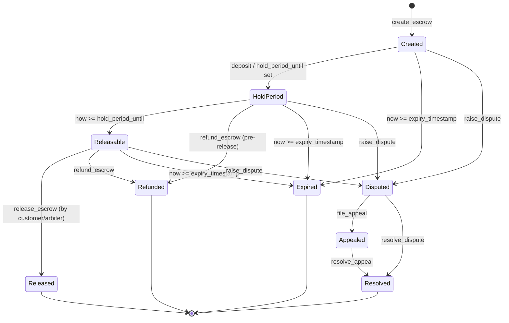
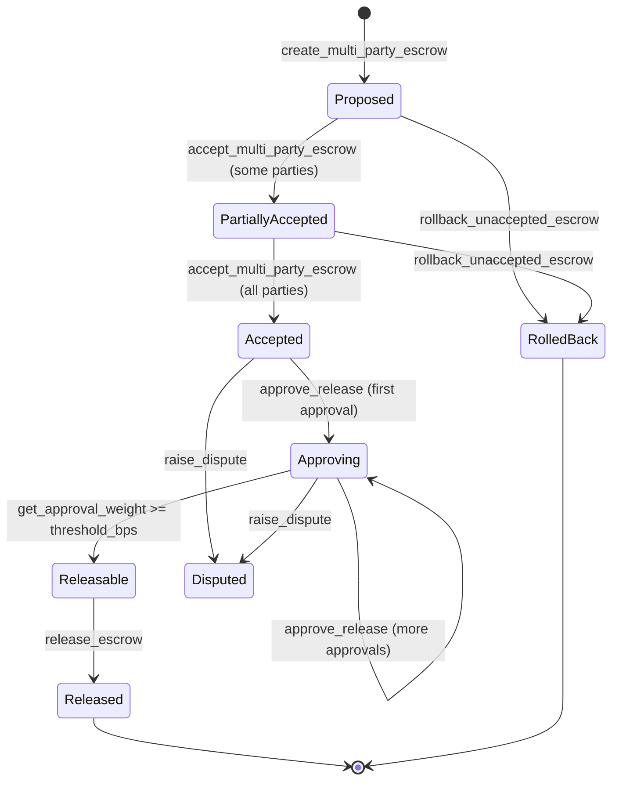
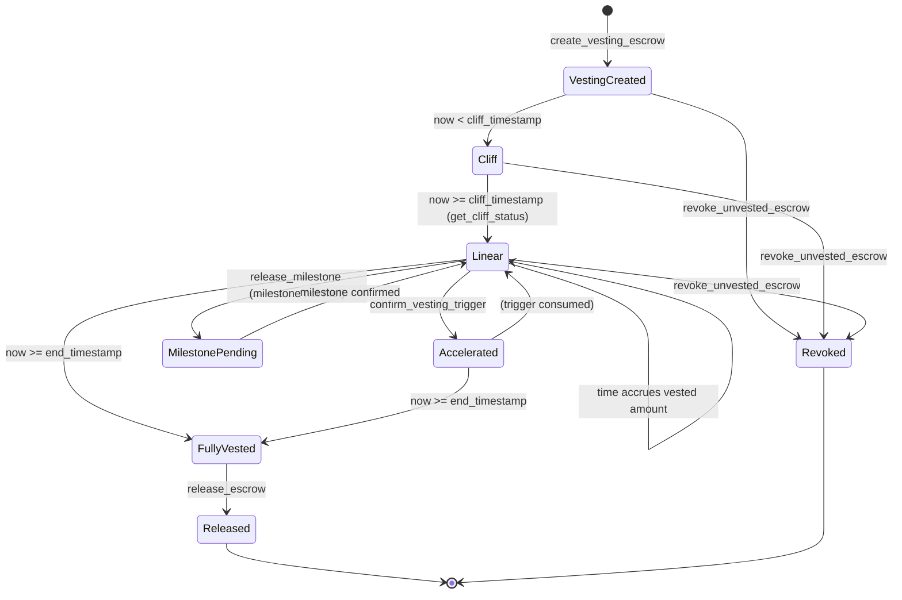
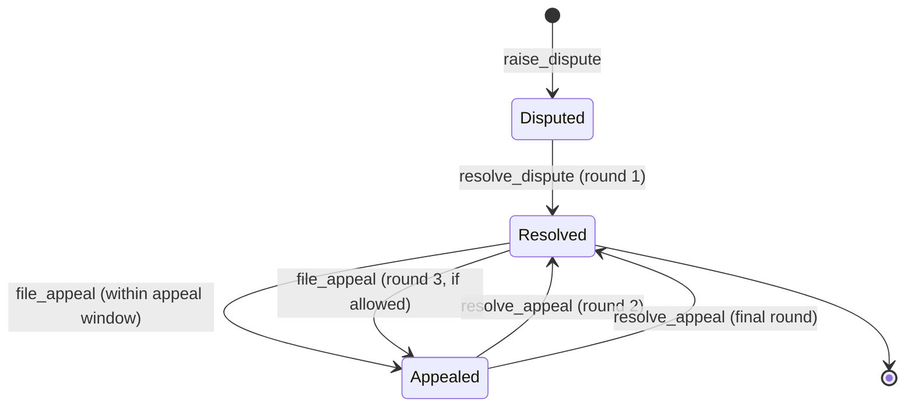

# Escrow & Multi-Party Vesting Lifecycle Guide

This guide documents the full lifecycle of the `Escrow` contract
(`core/contracts/escrow`). It covers standard escrows, multi-party weighted
escrows, vesting schedules (cliffs, linear curves, acceleration triggers,
milestones), collateral health & liquidation, and multi-round dispute appeals.

> Method signatures referenced here mirror `core/contracts/escrow/src/lib.rs`.
> If a signature drifts, the source of truth is always `lib.rs`.

---

## 1. Standard Escrow Lifecycle

A standard escrow moves through a small set of states. The three timestamps
(`hold_period_until`, `release_timestamp`, `expiry_timestamp`) gate the
transitions — see [§4](#4-timestamp-disambiguation).

### Terminal-state invariants

- **`Released` / `Refunded` / `Expired` are terminal.** No dispute may be
  opened once an escrow has been released, refunded, or expired
  (`raise_dispute` returns `EscrowError::AlreadyProcessed`).
- **Beneficiary transfers are blocked during an active dispute.** While an
  escrow is `Disputed` or `Appealed`, `transfer_beneficiary` and
  `confirm_beneficiary_transfer` are rejected (`EscrowError::InvalidStatus`).
- **`Resolved` is terminal for the escrow itself**, but the resolution may
  still be appealed within the appeal window (see §5).
- **`Expired` cannot be re-opened.** A new escrow must be created instead.

---

## 2. Multi-Party Initiation & Quorum Approval

Multi-party escrows require a quorum of weighted approvals before funds can be
released. Each participant has a weight; the release threshold is expressed in
basis points (`ReleaseThresholdBps`).

### Key methods

| Method | Purpose |
| --- | --- |
| `accept_multi_party_escrow(env, escrow_id, participant)` | Records a participant's acceptance. |
| `rollback_unaccepted_escrow(env, escrow_id)` | Cancels an escrow that never reached full acceptance. |
| `approve_release(env, escrow_id, approver)` | Registers a weighted approval toward the release threshold. |
| `get_approval_weight(env, escrow_id)` | Returns the current accumulated approval weight (bps). |

### Worked example — weighted quorum bps rounding

Suppose three parties with weights `5000`, `3000`, `2000` bps (total `10000`)
and a release threshold of `6667` bps (≈ 2/3).

1. Party A approves → `get_approval_weight = 5000`. `5000 < 6667` → not releasable.
2. Party B approves → `5000 + 3000 = 8000`. `8000 >= 6667` → **releasable**.
3. Party C approves → `8000 + 2000 = 10000` (capped at `10000`).

Rounding rule: weights are summed as integers in bps and compared with
`>=` against the threshold. There is no floating-point rounding; a threshold
of `6667` is satisfied by `8000` but **not** by `6666`. Always compute the
threshold as `ceil(required_fraction * 10000)` to avoid off-by-one rejections.

---

## 3. Vesting & Milestone Release

Vesting escrows release funds over time, optionally gated by a cliff,
acceleration triggers, and discrete milestones.

### Key methods

| Method | Purpose |
| --- | --- |
| `create_vesting_escrow(env, ...)` | Creates an escrow with a vesting schedule (cliff, linear curve, milestones). |
| `get_cliff_status(env, escrow_id)` | Returns whether the cliff has been reached and the vested amount so far. |
| `confirm_vesting_trigger(env, escrow_id, trigger)` | Confirms an acceleration trigger (e.g. oracle event). |
| `release_milestone(env, escrow_id, milestone_id)` | Releases the tranche tied to a specific milestone. |
| `revoke_unvested_escrow(env, escrow_id)` | Revokes the unvested remainder; vested funds stay with the beneficiary. |

### Worked example — cliff + linear + acceleration

Schedule: total `10_000` tokens, `start = 0`, `cliff = 100`, `end = 1000`,
linear curve, one acceleration trigger that doubles the rate after `t = 500`.

- **Before cliff (`t < 100`):** vested = `0`.
- **At cliff (`t = 100`):** vested = `10_000 * (100 - 0) / (1000 - 0) = 1_000`.
- **At `t = 500` (no acceleration):** vested = `10_000 * 500 / 1000 = 5_000`.
- **Acceleration confirmed at `t = 500`:** remaining `5_000` vests at 2× rate,
  so it completes at `t = 500 + 250 = 750`.
- **At `t = 750`:** vested = `10_000` (fully vested).

Rounding: vested amounts are computed with integer division and **truncate
down**; the beneficiary never receives more than the schedule allows. The
final tranche is adjusted so the sum of all tranches equals the total exactly.

---

## 4. Timestamp Disambiguation

Three timestamps gate different transitions. They are **not** interchangeable.

| Field | Meaning | Gates |
| --- | --- | --- |
| `hold_period_until` | Mandatory cooling-off period after creation. Funds cannot be released before this. | `HoldPeriod → Releasable` |
| `release_timestamp` | Earliest time the beneficiary may *request* release (e.g. after delivery). | `Releasable → Released` |
| `expiry_timestamp` | Hard deadline. After this, the escrow can only be refunded/expired. | `* → Expired` |

Invariants:

- `hold_period_until <= release_timestamp <= expiry_timestamp` must hold at
  creation; otherwise `create_escrow` returns `EscrowError::InvalidStatus`.
- `release_timestamp` does **not** override `hold_period_until`; both must be
  satisfied before release.
- Once `now >= expiry_timestamp`, `release_escrow` is rejected even if
  `release_timestamp` has passed.

---

## 5. Disputes, Appeals & Collateral Liquidation

- **Appeal window:** an appeal must be filed before `appeal_deadline`; after
  that the resolution is final.
- **Multi-round appeals:** each round increments `AppealCounter`; the maximum
  number of rounds is configured via `DisputeConfig`.
- **Collateral health factor:** `health = collateral_value / required_collateral`.
  If `health < 1.0`, the escrow is eligible for liquidation via
  `liquidate_collateral`. Liquidation transfers the collateral to the
  counterparty and marks the escrow `Resolved`.
- **Liquidation is blocked while a dispute is active** — the arbiter must
  resolve the dispute first.

---

## 6. Terminal-State Invariants (summary)

| State | Allowed transitions | Blocked operations |
| --- | --- | --- |
| `Released` | none | disputes, refunds, beneficiary transfers |
| `Refunded` | none | disputes, releases, beneficiary transfers |
| `Expired` | none | releases, disputes |
| `Resolved` | `Appealed` (within window) | beneficiary transfers |
| `Disputed` / `Appealed` | `Resolved` | beneficiary transfers, releases |
| `Revoked` (vesting) | none | further vesting, releases |

---

## 7. References

- Contract source: `core/contracts/escrow/src/lib.rs`
- Basic method reference: `core/contracts/escrow/README.md`
